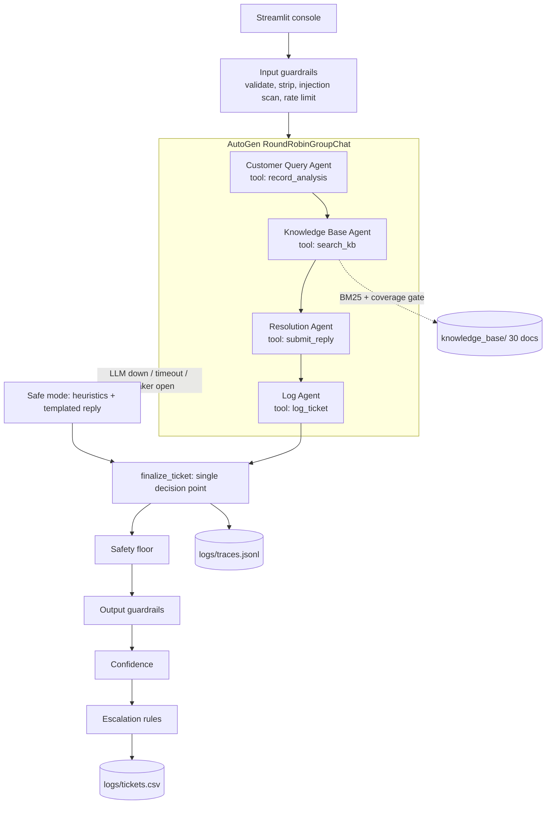

# Architecture

## Request flow

## Principle: the model proposes, code disposes

Every agent can only act through **one typed tool**. Enumerated arguments (`Literal` types) mean the
model cannot invent a category or urgency. After the agents finish, `core/ticketing.py::finalize_ticket`
re-checks everything in plain code and is the only place that decides status and writes the log.

| Concern | Left to the prompt (judgement, language) | Enforced in code (must be right) |
|---|---|---|
| Category / urgency / sentiment | Rubric and worked examples in the Query Agent prompt | Enum-typed tool args. Rules can **raise** urgency/sentiment (legal, fraud, payment dispute, safety, urgent wording) but never lower them |
| Which documents are relevant | Agent chooses the search query wording | BM25 + synonym canonicalisation + coverage gate: "no document" is a measurable fact, not the model's opinion |
| Reply tone, empathy, structure | Resolution prompt style guide | Fixed greeting/sign-off contract is checked; safe fallback reply if the draft fails any check |
| Facts in the reply (hours, amounts, emails, URLs, phones) | "Use only the passages" instruction | Every number, email, URL and phone number in the reply must appear in a retrieved passage, else the draft is replaced and the ticket escalated |
| Prompt injection | Prompts treat the complaint as data in `<customer_complaint>` tags | Regex detector flags it, forces escalation, and delimiter characters are neutralised |
| Escalation | Agent may *request* a human | Deterministic rules decide: only code can set status; an agent can add an escalation but never cancel one |
| Confidence | Agent reports high/medium/low | Blended with retrieval coverage; threshold in config |
| Ticket IDs, timestamps, CSV schema | Not the model's job | Store assigns IDs under a file lock; formula-injection protected |
| PII | Not trusted to the model | Cards (Luhn), emails, phones, Aadhaar, API keys and credentials redacted before logging |
| Outages | n/a | Timeout, retry, circuit breaker, safe mode; ticket always logged |

## Retrieval

Markdown is split on `##`/`###` headings into chunks that keep their file name and heading. Scoring is
BM25 with a small synonym map (refund/return/money back, broken/defective/faulty, ...) and light stemming.
A **coverage gate** then requires that the passage covers a minimum idf-weighted share of the query's
terms (`RETRIEVAL_MIN_COVERAGE`, default 0.42). That is what makes the "gift cards for 500 employees"
case return *no document*, while paraphrased real questions still match. Extra rules: a product named
(by name, alias or SKU) boosts its own sheet and the matching policy sits beside it; a category hint
boosts the matching policy. `RETRIEVER=hybrid` adds an optional embedding re-ranker that can only
**reorder** candidates that already passed the gate, so it can never turn "no match" into a match.

## Resilience

* `asyncio.wait_for` timeout and `LLM_MAX_ATTEMPTS` retries around the team run.
* `CircuitBreaker`: 3 consecutive failures open it for 30 s, so an outage does not make every user wait.
* **Safe mode**: heuristic analysis + KB search + templated reply, always escalated for a human, always logged.
* The Log Agent skipping its tool is recovered (`log_agent_skipped` flag) and the ticket is still written once (finalize is idempotent).
* `DEMO_MODE=true` uses a simulated agent team; it is labelled in the UI and in every log row (`pipeline_mode`), never silent.

## Observability

`logs/tickets.csv` (the required log, plus audit columns) and `logs/traces.jsonl` (one JSON line per
ticket: prompt version, every agent event, retrieved passages, flags, token usage, latency).
